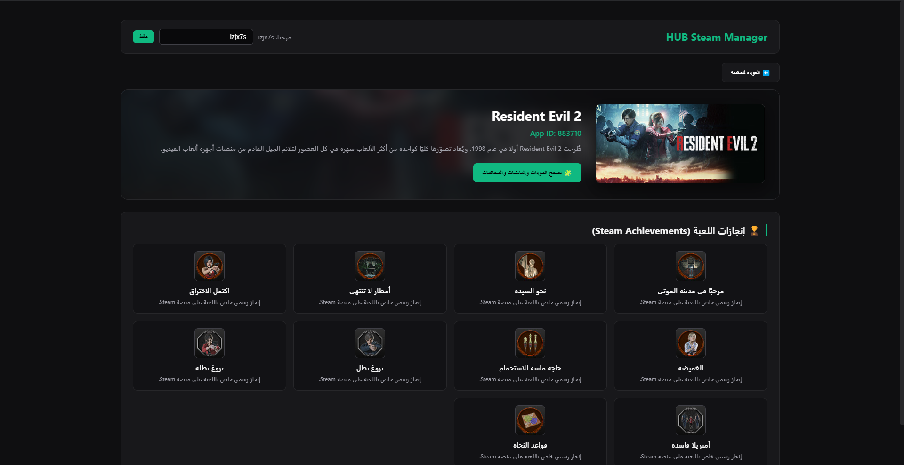
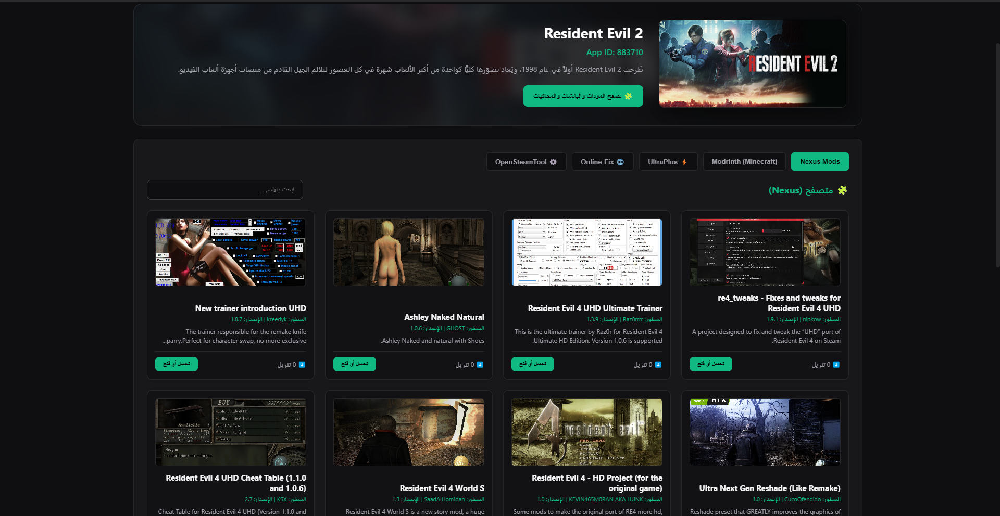

# 🎮 HUB Steam Manager

تطبيق سطح مكتب احترافي مبني باستخدام **Electron** لإدارة ألعاب Steam، يتيح لك استعراض وتصفح الألعاب بسلاسة، وحقن ملفات التجاوز والإدارة مباشرة في مسار التثبيت بخطوات بسيطة.

---

## ✨ المميزات الرئيسية

- **🔐 مصادقة Discord:** تسجيل دخول آمن وسريع عبر حساب ديسكورد مع عرض اسم المستخدم والصورة الشخصية.
- **📚 استعراض الألعاب:** جلب مئات الألعاب المتنوعة من قاعدة بيانات Steam مع تفاصيل شاملة (الوصف، المطور، صور المعرض، والتقييمات).
- **⚡ التثبيت والحقن المباشر:** حقن ملفات التجاوز وتكوين مسارات التطبيق في Steam بنقرة زر واحدة وصلاحيات المسؤول.
- **🔄 التحديثات التلقائية:** دعم كامل للتحديث التلقائي (Auto-Updates) عبر GitHub لضمان حصول المستخدمين دائماً على أحدث إصدار.
- **🎨 واجهة مستخدم عصرية:** تصميم داكن (Dark Theme) مخصص لمحبي الألعاب وخالٍ من التعقيد.

---

## 🚀 طريقة التثبيت والاستخدام

1. توجه إلى قسم [Releases](../../releases) في المستودع.
2. قم بتحميل أحدث ملف تثبيت بصيغة Setup (`.exe`).
3. شغّل الملف على جهازك واتبع خطوات التثبيت القياسية وسيظهر الاختصار على سطح المكتب.

---

## 🛠️ التقنيات المستخدمة

- **[Electron](https://www.electronjs.org/)** - الإطار الأساسي لبناء تطبيق سطح المكتب.
- **[Node.js / JavaScript](https://nodejs.org/)** - منطق الخلفية وتفاعل النظام.
- **[Axios](https://axios-http.com/)** - لجلب بيانات الألعاب من واجهات برمجة التطبيقات (APIs).
- **[Electron-Updater](https://www.electron.build/auto-update)** - لإدارة وتنزيل التحديثات تلقائياً.

---

## ⚠️ تنبيه قانوني

هذا التطبيق مخصص لأغراض الإدارة والتجربة المحلية وتحسين تجربة الألعاب الفردية، ويتحمل المستخدم وحده مسؤولية استخدامه.
